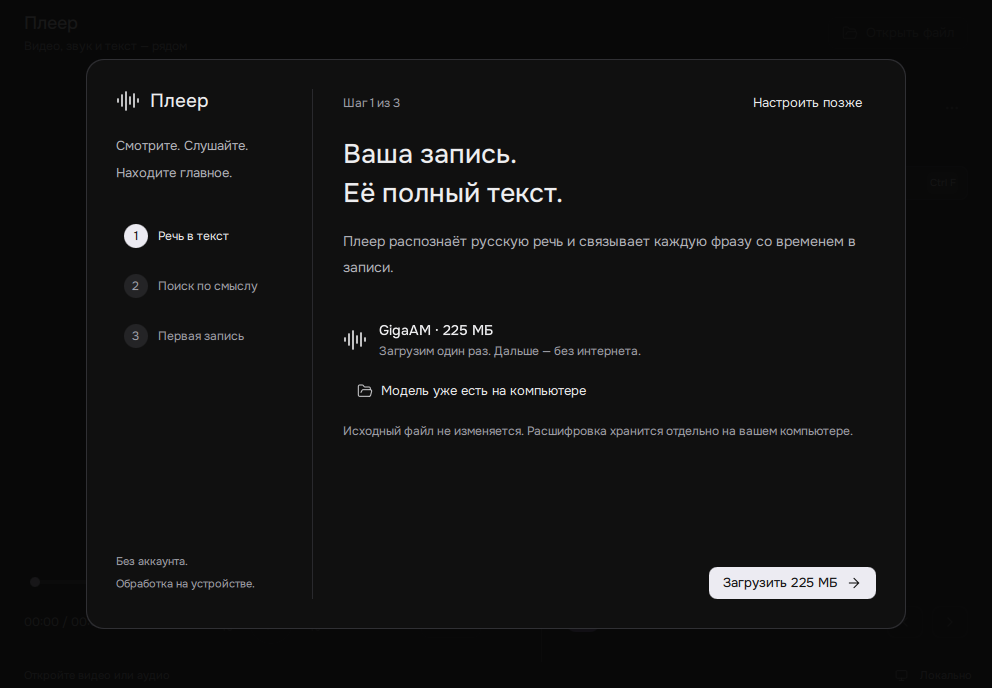

# AIPlayer

Настольный плеер для видео и аудио с локальной расшифровкой русской речи, поиском по записи и обрезкой фрагментов.

**[Скачать для Windows, macOS и Linux](https://github.com/krikkota/AIPlayer/releases/latest)** · [Сообщить о проблеме](https://github.com/krikkota/AIPlayer/issues)

## Установка

Выберите файл на [странице релиза](https://github.com/krikkota/AIPlayer/releases/latest):

| Система | Файл | Требования |
| --- | --- | --- |
| Windows | **AIPlayer-0.2.2-Windows-x64-Setup.exe** | Windows 10 22H2 / Windows 11, x64 |
| macOS | **AIPlayer-0.2.2-macOS-arm64.dmg** | macOS 14+, Apple Silicon (серия M) |
| Linux | **AIPlayer-0.2.2-Linux-x64.tar.gz** | Ubuntu 24.04 x64 |

### Windows

Запустите EXE, завершите установку и откройте AIPlayer. Python и библиотеки уже входят в установщик; права администратора не нужны. Размер — около 96 МБ. Сертификата издателя пока нет: Windows может показать предупреждение о неизвестном издателе.

### macOS

Откройте DMG и перетащите **AIPlayer.app** в **Applications / Программы**. Затем откройте AIPlayer из «Программ». Размер DMG — около 113 МБ. Сборка для Apple Silicon; на Intel Mac она не запускается.

Приложение пока без Developer ID и нотариальной проверки Apple. macOS может заблокировать первый запуск. Если вы доверяете скачанному файлу, после попытки запуска откройте **Системные настройки → Конфиденциальность и безопасность → Всё равно открыть** и подтвердите запуск AIPlayer. Это отдельное разрешение для приложения; отключать защиту системы не нужно. [Инструкция Apple](https://support.apple.com/102445).

### Linux

Распакуйте архив целиком и запустите файл `AIPlayer` из распакованной папки. Из терминала это `./AIPlayer`. Проверено на Ubuntu 24.04 x64. Для запуска в X11 или XWayland могут понадобиться библиотеки Qt. Для Ubuntu установите их командой:

```sh
sudo apt install libegl1 libgl1 libopengl0 libxcb-cursor0 libxcb-keysyms1 libxcb-xinerama0 libxkbcommon-x11-0 libxcb-icccm4 libxcb-image0 libxcb-render-util0 libxcb-util1 libxcb-shape0 libxcb-xinput0
```

### Первый запуск

1. Приложение предложит загрузить модель распознавания **GigaAM, около 225 МБ**. После загрузки распознавание работает без интернета.
2. По желанию подключите [Ollama](https://ollama.com/) для поиска по смыслу. Для обычной расшифровки и поиска слов она не нужна.
3. Откройте или перетащите аудио- или видеофайл.

В настройке расшифровки можно отдельно загрузить **SaT INT8 (251 МБ)**. Плеер использует её на CPU для уточнения границ фраз после пауз, сохраняя слова и таймкоды. Переключатель находится в разделе «Модели и подключение». Модель хранится отдельно от приложения.

Это ранняя версия приложения. Скачивайте файлы только из релизов этого репозитория. Версия 0.2.2 заменяет предыдущую; настройки и уже загруженные модели сохраняются.



## Что умеет

- Воспроизводить видео и аудио, менять скорость, переходить вперёд и назад.
- Распознавать русскую речь локально и связывать каждую фразу с её временем в записи.
- Искать слова в расшифровке, подсвечивать совпадения и переключаться между ними.
- Находить обсуждение темы через локальную модель Ollama. Поиск по смыслу запускается по кнопке и не нужен для остальных функций.
- Обрезать видео и аудио с точными границами и предварительным прослушиванием.
- Экспортировать расшифровку в текст и SRT.

Выбор смысловой модели находится в шестерёнке раздела поиска по смыслу. Поддерживаются совместимые локальные модели до 3 ГБ. Модели устанавливаются и обслуживаются через Ollama. Разделение по говорящим и автоматические главы пока не реализованы.

## Данные и качество поиска

Записи и расшифровки обрабатываются на компьютере. Приложение не отправляет их в облачный сервис; для смыслового поиска обращается к локальной Ollama на `127.0.0.1:11434`. Интернет нужен для первоначальной загрузки моделей. Модели не входят в установщик.

Исходная запись при экспорте не перезаписывается. Обрезка видео сохраняет MP4 с перекодированием H.264/AAC, поэтому не является побитовым копированием. Аудио можно сохранить в WAV, FLAC или M4A.

Смысловой поиск зависит от выбранной модели: он может пропускать подходящие моменты и включать лишние. Важные результаты проверяйте по записи. Распознавание также может ошибаться.

## Если что-то не работает

Создайте [issue](https://github.com/krikkota/AIPlayer/issues) с версией приложения, Windows и описанием действий. При ошибке запуска приложение показывает сообщение и сохраняет журнал:

```text
%LOCALAPPDATA%\LocalMedia\Player\logs\startup.log
```

На macOS журнал расположен в `~/Library/Application Support/LocalMedia/Player/logs/startup.log`.

Перед публикацией журнала проверьте его: в нём могут быть пути к вашим файлам. Не прикладывайте личные записи и расшифровки без необходимости.

## Другие платформы и разработка

Одна кодовая база использует Python и Qt/PySide6 и рассчитана на macOS, Windows и Linux. В этом релизе есть установщик Windows x64, DMG для Mac с Apple Silicon и переносимый пакет для Ubuntu 24.04 x64. Сборки macOS Intel, Windows ARM и Linux ARM не входят в этот релиз.

Для запуска исходников нужен Python 3.12:

```sh
python -m venv .venv
# Активируйте окружение для своей ОС.
python -m pip install -c constraints.txt -r requirements-build.txt
python -m pip install --no-build-isolation -c constraints.txt -e .
python launcher.py
```

Проверки и сборка:

```sh
python -m pytest -q
python build.py
```

DMG для macOS создаётся командой `python packaging/build_macos_dmg.py` после `python build.py`.

Для установщика Windows дополнительно нужен Inno Setup 7: `build_windows.cmd`. Сборка выполняется на целевой ОС. [Workflow](.github/workflows/windows-installer.yml) проверяет запуск упакованного приложения, настоящую установку и открытие установленного приложения с чистыми настройками и путём с кириллицей.

[Проверка Windows 0.2.1](docs/WINDOWS-INSTALLER.md) · [Проверка macOS 0.2.1](docs/MACOS-RELEASE.md) · [Проверка безопасности](docs/SECURITY-REVIEW.md) · [Сторонние компоненты и лицензии](licenses/README.md)
